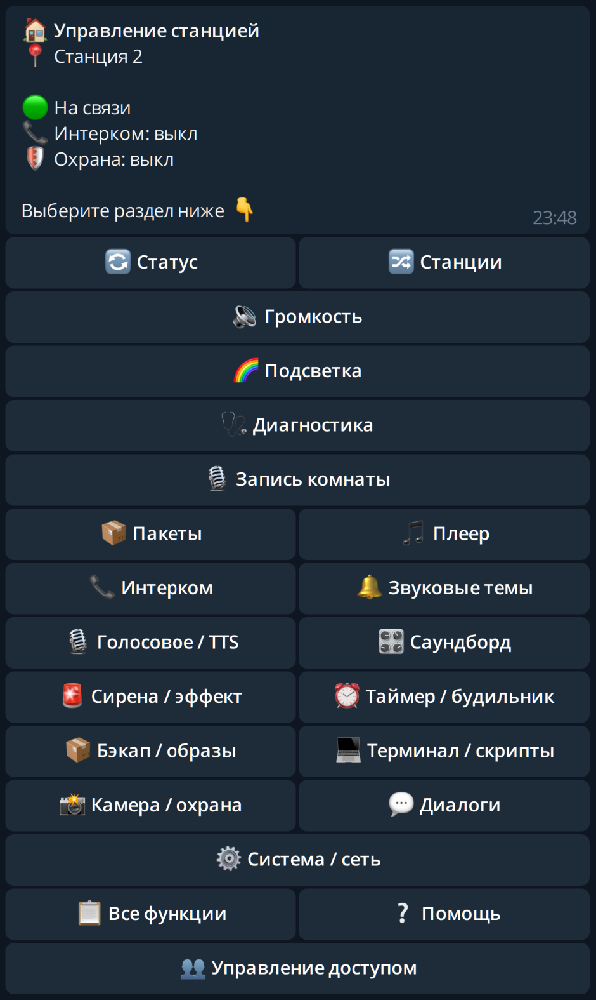

# Yandex Station Telegram Control Bot



**3.0.0b10:** установщики Windows/Linux ставят бот на ПК/сервер и закреплённую LUNA на квалифицированные колонки. Голосовые, саундборд, TTS, темы, интерком, экран, таймеры, камера хоста, бэкапы, терминал и скрипты управляются кнопками. См. [изменения](CHANGELOG.md) и [границы функций](docs/FEATURE_PARITY.md).

Telegram-интерфейс управления Яндекс Станциями через **LUNA**. Исходный Bot Control 2.7 от **@q_cold_city и @mipight** сохранён в ветке [`alfa`](https://github.com/chelaxian/Yandex-Station-Telegram-Control-Bot/tree/alfa). Разработка нового runtime ведётся в `main` по запросу владельца.

Управление работает через карточки и кнопки: выберите громкость, цвет, звук, длительность записи или таймер. Для текста и файлов бот предложит следующий шаг. `/cancel` отменяет ввод; кнопка «Главное меню» всегда возвращает к разделам. Ответы в чате не содержат технических JSON-дампов.

> **3.0.0b10 — beta.** ПК/сервер должен оставаться включённым. Полностью автономный бот внутри колонки в этот установщик не входит. Провайдер штатного музыкального плеера и квалификация остальных моделей ещё не завершены.

## Установка в один запуск

**Статус b5: кандидат для проверки установщика.** Unit-тесты и сборка проверены; полный первый запуск на чистой Windows/Linux и новый managed path на колонках ещё не квалифицированы. Рабочий deployment бота на мини-ПК проверен отдельно и не доказывает этот установочный сценарий.

Скачайте **installer-архив** в [GitHub Releases](https://github.com/chelaxian/Yandex-Station-Telegram-Control-Bot/releases), распакуйте и запустите установщик. Архивы `Source code` не содержат бинарников LUNA и не подходят для этого сценария.

Перед запуском нужны токен от @BotFather, ваш числовой Telegram ID и IP колонок в той же частной сети. На колонках **уже должен работать root ADB на порту 5555**. Установщик не получает root, не разблокирует обычную колонку и не прошивает её. Остановите прежний экземпляр бота с тем же токеном: один токен должен обслуживать один poller.

### Windows 10/11 x64

1. Распакуйте `stationbot-3.0.0b10-installer.zip`.
2. Дважды нажмите **install.cmd**. Нужен Microsoft App Installer (`winget`); Windows может запросить стандартное подтверждение установки зависимостей.
3. Введите ID, скрытый токен, при необходимости Telegram proxy, часовой пояс и IP колонок через запятую.

Скрипт установит Python3.12, ADB, ffmpeg и espeak-ng через WinGet, создаст отдельное окружение и фоновую задачу `YandexStationTelegramControlBot`. Данные находятся в `%LOCALAPPDATA%\YandexStationTelegramBot`, доступ ограничен вашим аккаунтом и SYSTEM. Автозапуск выполняется **после входа этого пользователя в Windows**, а не до входа в систему. Для постоянно работающего сервера удобнее Linux/systemd.

### Linux: Debian 12 / Ubuntu 22.04 и новее

Распакуйте `stationbot-3.0.0b10-installer.tar.gz`, откройте терминал в полученной папке и выполните:

```bash
bash ./install.sh
```

Скрипт запросит sudo для системных зависимостей, затем установит пользовательскую службу systemd и включит linger для запуска без открытой SSH-сессии. Данные: `~/.local/share/stationbot` (или `$XDG_DATA_HOME/stationbot`). На сервере при запуске от root создаётся отдельный системный пользователь `stationbot`, каталог `/opt/stationbot-oneclick` и системная служба. Установка не добавляет bot token в unit или командную строку.

### Что происходит на колонке

Модель проверяется **до записи** по root UID, архитектуре ядра, device-tree board и семейству прошивки. В этом релизе автоматическая установка квалифицирована для:

| Колонка | Board | Retail-прошивка |
|---|---|---|
| Мини 3 Про | `Yandex Pickle EVT` | `.50.4795647264.*` |
| Станция 2 | `Yandex Station Midi` | `.50.4794649087.*` |
| Лайт 2 Plum (экспериментально) | `Yandex Plum EVT2` | `.50.4795647582.*` |

Название board `Midi` само по себе не определяет коммерческую модель: другое семейство прошивки будет отклонено. На неподдерживаемом устройстве установщик остановится, а не попробует чужой бинарник.

LUNA размещается в `/data/local/stationbot-luna`, слушает только `127.0.0.1:18100` и подключается через ADB forward. Нужны минимум16МиБ свободной постоянной памяти. Аудиозадания используют отдельный каталог в `/tmp`; собственные настройки LUNA сохраняются. Rootfs, OTA, SSH-защита и чужие процессы не меняются. Owner tools включены для терминала/скриптов; API не публикуется в LAN или интернет.

**После перезагрузки колонки LUNA поднимает служба на ПК/сервере.** Отдельные vendor boot hooks не устанавливаются. При выключенном хосте бот не работает; это выбранный режим «бот на хосте + LUNA на колонках».

### Обновление и проверка

Для обновления распакуйте новый installer-архив и запустите тот же скрипт. Настройки, токен, SQLite, роли, звуки и история сохраняются. Создаются новое окружение и резервные копии конфигурации; предыдущий бинарник LUNA сохраняется. При ошибке готовности LUNA возвращается предыдущая версия. Конфликт чужого каталога, службы или ADB-порта не перезаписывается.

Проверка без установки: `install.ps1 -Check` в PowerShell или `bash install.sh --check` в Linux. Для подготовки окружения без настройки колонок и запуска бота: `install.ps1 -PrepareOnly` / `bash install.sh --prepare-only`. Эти режимы требуют распакованный installer-архив.

### Если установка остановилась на проверке колонки

Установщик печатает точную причину: недоступный ADB, неподходящие root/архитектуру или конкретные board/firmware. Остановка на этом этапе означает, что файлы на колонку не записывались.

1. Проверьте в роутере, что указан IP именно колонки из той же LAN-подсети, и что ПК может подключиться к порту 5555.
2. Выполните диагностические команды и сохраните их вывод:

   ```sh
   adb connect <IP>:5555
   adb -s <IP>:5555 get-state
   adb -s <IP>:5555 shell id -u
   adb -s <IP>:5555 shell uname -m
   adb -s <IP>:5555 shell cat /proc/device-tree/model
   adb -s <IP>:5555 shell cat /system/vendor/quasar/version_full
   ```

3. Автоматическая установка квалифицирована только для Мини 3 Про `Yandex Pickle EVT` на `.50.4795647264.*`, Станции 2 `Yandex Station Midi` на `.50.4794649087.*` и экспериментального Лайт 2 Plum `Yandex Plum EVT2` на `.50.4795647582.*`. Для другой модели/прошивки установщик обязан остановиться; сообщите вывод board/firmware в Issue для планирования поддержки.
4. Если ADB отвечает `unauthorized`, подтвердите отладку на экране колонки. Если `offline`/timeout — проверьте VPN, изоляцию Wi-Fi-клиентов и файрвол.

Служба Linux: `systemctl --user status stationbot-oneclick`; системная установка root: `sudo systemctl status stationbot-oneclick`. В Windows состояние видно в Планировщике заданий под именем `YandexStationTelegramControlBot`.

В `bundle.json` перечислены SHA-256 файлов комплекта; `SHA256SUMS` в релизе проверяет сами архивы. Зависимости ОС и Python скачиваются при установке — полностью offline-установка не заявляется. [Текст поста для Telegram](docs/TELEGRAM_RELEASE_POST.md) подготовлен отдельно; скриншот находится в `docs/assets/telegram-main-menu.png`.

## Что изменилось

Вместо монолита с ADB-командами используется Python-пакет: асинхронный Telegram router → сервис доступа/операций → типизированный HTTP-адаптер LUNA → station backend. Новый runtime не угадывает пути sysfs, ALSA mixer, разделы Flash и коммерческую модель по похожему codename.

- Несколько станций; выбранное устройство хранится отдельно для каждого пользователя. Кнопки содержат конкретную станцию.
- Проверка `expected_model`, актуальных capabilities, topology LED, доступности часов и микрофонов перед действиями.
- Громкость, ring/logo и их release, часы, датчики, WAV-запись, тест звука, установленные пакеты и медиапровайдеры через существующие LUNA endpoints.
- Роли owner/operator/viewer; приглашение по `@username` требует подтверждения владельцем и затем закрепляется за числовым ID.
- SQLite WAL, сериализация действий на каждой станции, защита от дубликатов, явное `unknown` после сбоя, таймеры с восстановлением и ограниченный журнал метаданных.
- Записи комнаты передаются из памяти; новый runtime не сохраняет их на диск. Нельзя обещать удаление данных из Telegram, swap, дампов памяти или инфраструктуры Telegram.
- Существующий Telegram proxy задаётся через окружение. `/station ID` сохраняет прежний способ выбора, `/legacy_history` читает приватную историю прежнего бота без изменения файлов. Команды из старой очереди Telegram не выполняются после запуска.

## Быстрый старт

Нужны Python **3.10+**, Telegram bot token, уже работающая LUNA и защищённый доступ к ней. Корень файловой системы колонки не изменяется установкой этого Python-пакета.

```powershell
python -m venv .venv
.venv\Scripts\python.exe -m pip install -e .
Copy-Item config.example.toml config.toml
# Измените owner_id, станции, expected_model и адреса существующих туннелей.
# TELEGRAM_BOT_TOKEN задайте через локальное хранилище секретов/окружение.
.venv\Scripts\python.exe -m stationbot --config config.toml doctor
.venv\Scripts\python.exe -m stationbot --config config.toml run
```

Linux: используйте `.venv/bin/python`. `doctor` не требует токена Telegram, не посылает сообщения и не меняет устройства; он проверяет идентификацию LUNA. `/menu`, `/stations` и `/help` доступны в личном чате после запуска.

Секреты задаются только через переменные окружения. Рабочие конфигурации, записи, БД и сессии исключены из Git. Не запускайте второй poller с тем же Telegram token: блокировка state-dir защищает только один локальный каталог.

## Совместимость и доверие

Контракт beta закреплён на [`chelaxian/luna@0f2393e`](https://github.com/chelaxian/luna/commit/0f2393e4d613472c79755b358abc3047a9466963): audio jobs и отдельно включаемые owner tools поверх аппаратной адаптации [PR24](https://github.com/nyakokitsu/luna/pull/24). Это не обещание наличия расширений в официальном релизе upstream. Строка версии Cargo сама по себе не подтверждает нужный commit.

Административный HTTP API LUNA **не имеет аутентификации**. Используйте loopback через существующий SSH tunnel или собственный HTTPS proxy с Bearer-проверкой. `X-Luna-Token` предназначен для запущенного плагина, а не для защиты admin API. Не открывайте порт runtime в интернет. Клиент не следует redirect, не наследует системный HTTP proxy и проверяет TLS по умолчанию.

Код не содержит жёсткого списка поддерживаемых моделей: он проверяет runtime contract и возможности устройства. Аппаратная квалификация доступна для Станции 2, Мини 3 Про и экспериментального Лайт 2 Plum; она имеет [явные пределы](docs/LUNA_CONTRACT.md). Отсутствие квалификации других моделей не заменяется формулировкой «поддерживаются все».

## Разработка

Как проверить свою модель, добавить поддержку функций и подготовить проверенный PR: **[руководство для контрибьютеров и ИИ-агентов](CONTRIBUTION.md)**.

```sh
python -m pip install -e '.[dev]' -c requirements.lock.txt
python -m ruff check src tests
python -m pytest -q
python -m build
```

CI проверяет Windows/Linux, Python 3.10/3.12. Тесты используют синтетический WAV, HTTP fixtures и fake Telegram session; реальные боты и микрофоны не задействуются. Снимок зависимостей — `requirements.lock.txt`, не lock для всех будущих платформ и версий Python.

Исходники и материалы 2.7 хранятся только в исторической ветке [`alfa`](https://github.com/chelaxian/Yandex-Station-Telegram-Control-Bot/tree/alfa). В `main` находится только новый бот; старые установщики не используются. Происхождение и санитарные изменения описаны в [IMPORT_PROVENANCE.json](IMPORT_PROVENANCE.json). Право переиздать сторонний код или звуковые материалы под новой лицензией не предполагается; см. [NOTICE](NOTICE.md).

### VPN и адрес колонки

Новый установщик запрашивает IP вручную и не определяет подсеть по интернет-маршруту. Возьмите настоящий IP колонки из списка клиентов роутера: `10.x`, `172.16–31.x` или `192.168.x`. VPN fake-IP `198.18.x` отклоняется до ADB-подключения; VPN с адресом из RFC1918 нельзя отличить от LAN только по самому адресу. Если VPN блокирует LAN, разрешите локальную сеть в настройках VPN; установщик не меняет маршруты и не отключает VPN. Поиск `/discover` сканирует только явно указанную владельцем RFC1918-подсеть /24 или меньше.

Разбор сообщения о сбросе после установки 2.7 и границы проверки нового кода: [аудит установщика и операций](docs/INSTALLER_SAFETY_REVIEW.md).
