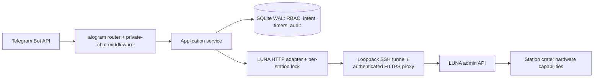

# Архитектура

`config.py` валидирует адреса и canonical model; секреты остаются в окружении. `luna.py` реализует изученные endpoints. `service.py` проверяет роль перед очередью и повторно перед действием. `telegram.py` отвечает за private-chat boundary, меню и доставку. `store.py` хранит роли, аудит, таймеры, явно отправленные предложения и диалоги `/ask`. `audio.py` ограничивает конвертацию и синтез; `assets.py` проверяет ZIP/хеши и сохраняет прежние данные при restore. `interactions.py` владеет отменяемыми задачами интеркома, RGB и камеры; при старте они выключены. Импорт модулей не запускает сервисов и не открывает устройств.

## Поведение при сбоях

- Перед действием сохраняется уникальный request ID. Дубликат не повторяет физическую операцию.
- Статусы `running` после рестарта становятся `unknown`; никакого автоматического replay. Это at-most-once intent, а не обещание exactly-once в распределённой системе.
- Per-station lock изолирует операции на одном устройстве; разные устройства не блокируют друг друга. Дополнительно ограничены rate/user, активные пользовательские запросы, HTTP connections и concurrency диспетчера.
- Durable timers уведомляют в Telegram. Crash в промежутке отправки сохраняет неопределённость; отправка не повторяется вслепую. Просроченное уведомление помечается задержкой.
- Один OS-lock на state-dir исключает локальную гонку процессов. Один Telegram token должен обслуживаться одним poller во всей инфраструктуре.
- Запись WAV только по явной команде operator/owner; аудио в памяти, без фонового прослушивания. Дамп процесса/swap/сторона Telegram находятся вне гарантии очистки приложения.
- Отзыв роли проверяется перед новой станционной операцией и отменяет будущие таймеры. Уже начатое аппаратное действие нельзя надёжно отменить текущим API.

## Дальнейшие границы

Privileged maintenance, VoIP, camera и synthesis/playback следует оформлять отдельными provider-модулями с явным контрактом, capability negotiation, лимитами и квалификацией каждой модели. Shell fallback, универсальная запись разделов и обход rootfs read-only не являются допустимой подменой отсутствующего API. Реализованные audio jobs и owner tools описаны в LUNA_CONTRACT.md; камера/конвертация/TTS — модули хоста. Наличие provider не отменяет проверки конечного результата. Штатный музыкальный provider и автономная упаковка остаются partial.
